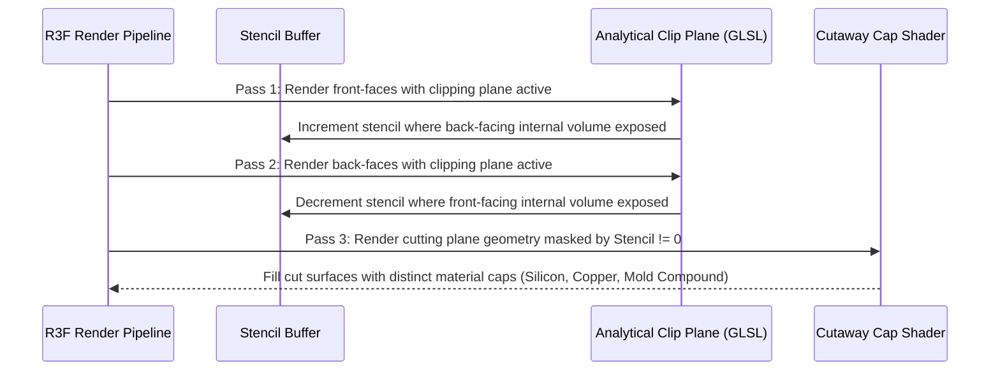

# 3D Lab — System Architecture Specification

**Document Version:** 1.0.0  
**Status:** Approved  
**Author:** Lead Software Architect

---

## 1. High-Level Architectural Overview

3D Lab is architected as a high-performance, modular, client-centric web application with strict decoupling between the **Presentation Layer (React + Tailwind)**, the **3D Graphics Engine (Three.js / React Three Fiber)**, the **Electrical Simulation Engine (ngspice WebAssembly + Web Worker)**, and the **Unified Domain Model**.

```mermaid
flowchart TB
    subgraph UI_Layer [Presentation & Workspace UI Layer]
        Shell[Next.js App Router / Workspace Shell]
        Nav[Environment Switcher & Toolbars]
        HUD[Telemetry HUD & Instrument Panels]
        Inspector[Properties & Layer Inspector]
    end

    subgraph State_Bus [Unified Reactive State Management (Zustand)]
        AppStore[Workspace Session Store]
        CircuitStore[Circuit Graph & Netlist Store]
        SimStore[Simulation Results & Telemetry Store]
        ViewStore[Camera & Viewport Cutaway Store]
        HistoryStore[Temporal Undo / Redo Manager]
    end

    subgraph Graphics_Engine [3D Graphics Engine (React Three Fiber / Three.js)]
        Canvas[R3F Canvas & Post-Processing Pipeline]
        SceneGraph[Hierarchical Scene Graph]
        LODManager[LOD & Asset Streamer]
        CutawayEngine[Stencil-Buffered Cutaway & Shader Manager]
        AnimDriver[Simulation-Driven Shader Uniform Pipeline]
    end

    subgraph Simulation_Subsystem [Simulation Subsystem (Dedicated Web Worker)]
        NetlistGen[AST & Netlist Compiler]
        SolverRouter{Solver Strategy Router}
        FastMNA[Real-Time Interactive MNA Solver (JS/Wasm)]
        NgspiceWasm[ngspice High-Precision Solver (WASM)]
        RingBuffer[(SharedArrayBuffer / Transferable Stream)]
    end

    subgraph Native_Bridge [Desktop Readiness Layer]
        TauriAdapter[Tauri / Electron Hardware & FS Bridge]
    end

    UI_Layer <--> State_Bus
    State_Bus <--> Graphics_Engine
    State_Bus <--> Simulation_Subsystem
    Simulation_Subsystem -- High-Frequency Data Stream --> AnimDriver
    Graphics_Engine -. Runs in .-> Canvas
    State_Bus <--> Native_Bridge
```

---

## 2. Technology Stack & Decision Rationale

| Layer / Concern | Technology Selection | Architectural Rationale & Trade-Offs |
| :--- | :--- | :--- |
| **Framework & Routing** | **Next.js (App Router) + React 19** | Zero-latency client routing, streaming SSR for marketing/docs, optimal code-splitting, tree-shaking, and static export support for desktop packaging. |
| **Language & Typings** | **TypeScript 5.x (Strict Mode)** | End-to-end type safety across circuit graphs, SPICE netlist ASTs, 3D asset manifests, and worker RPC protocols. |
| **3D Rendering Core** | **Three.js + React Three Fiber (R3F) + Drei** | Declarative scene graph composition with imperative escape hatches for render-loop hot paths; battle-tested ecosystem; WebGL2 standard with direct WebGPU path via Three.js WebGPURenderer. |
| **Styling & Design System** | **Tailwind CSS + Radix UI Primitives** | Zero runtime CSS overhead, accessible unstyled primitives for complex docks, inspectors, and toolbars, uniform design tokens. |
| **Client State Management** | **Zustand + Immer** | Minimal boilerplate, unopinionated outside React render cycle (crucial for 60/120 FPS callbacks in 3D frame loops without React re-render cascades). |
| **Simulation Engine** | **ngspice (C source compiled to WebAssembly via Emscripten)** + **Custom MNA Solver** | ngspice provides gold-standard industrial accuracy (BSIM models, transient, AC, Fourier). The companion MNA solver handles interactive 60 FPS breadboard interactions. |
| **Multi-Threading** | **Dedicated Web Workers + SharedArrayBuffer / Transferable Objects** | Keeps the UI and 3D rendering pipeline uninterrupted at 60–140 FPS while solving stiff differential equations on a background core. |
| **Desktop Deployment Target** | **Tauri (v2.x) / Electron** | Native binary bundling, low memory footprint, direct local file system access for user project `.3dlab` files, and hardware GPU acceleration. |

---

## 3. Modular Monorepo Structure

The project is structured into clear, decoupled domain packages:

```
3d-lab/
├── apps/
│   ├── web/                     # Next.js Web Application
│   └── desktop/                 # Tauri native packaging wrapper
├── packages/
│   ├── core-model/              # Domain models, Circuit Graph AST, Component Schemas
│   ├── 3d-engine/               # R3F components, shaders, cutaway manager, asset loaders
│   ├── simulation-engine/       # Netlist compiler, Web Worker, MNA solver, ngspice-wasm bindings
│   ├── ui-system/               # Design system tokens, Radix wrappers, HUD overlays, canvas dock
│   ├── catalog-data/            # Component definitions, 3D GLB assets, SPICE subcircuits
│   └── curriculum/              # Learning Academy lessons, quizzes, interactive challenges
├── tools/
│   ├── asset-pipeline/          # glTF optimization, Draco/Meshopt CLI, KTX2 texture compressor
│   └── spice-validator/         # Netlist test runner validating ngspice vs hardware bench data
└── docs/                        # Specifications, PRDs, Schemas
```

### Module Boundaries & Invariants
1. **`core-model` has ZERO external 3D or DOM dependencies.** It contains pure TypeScript interfaces, mathematical validation routines, graph topologies, and serialization schemas.
2. **`simulation-engine` communicates exclusively via asynchronous message passing / RPC.** No Three.js or DOM objects may cross the worker boundary; all simulation payloads are typed flat buffers or JSON-serializable ASTs.
3. **`3d-engine` never directly executes simulation calculations.** It consumes read-only telemetry buffers (voltages, currents, temperatures) from `simulation-engine` to update uniforms and vertex attributes.

---

## 4. 3D Rendering & Cutaway Architecture

### 4.1 Asset Optimization & Streaming Strategy
To guarantee sub-second load times and high frame rates:
- **Geometry Format:** Compressed binary `glTF 2.0` (`.glb`) processed with **Meshopt** and **Draco**.
- **Materials & Textures:** PBR metallic-roughness materials with **KTX2 / Basis Universal** GPU-compressed textures (UASTC for normal maps, ETC1S for albedo/roughness).
- **Hierarchical LOD (Level of Detail):**
  - **LOD 0 (Macro View / Circuit Workspace):** Simplified exterior packaging, optimized pins ($<2{,}000$ triangles).
  - **LOD 1 (Component Inspection):** Detailed exterior with molded text, chamfers, and leads ($5{,}000 - 15{,}000$ triangles).
  - **LOD 2 (Internal Cutaway View):** Die, wirebonds, leadframe, sub-micron silicon structures, dynamic clipping planes ($25{,}000 - 70{,}000$ triangles). Loaded lazily when zooming into or inspecting a specific component.

### 4.2 Dynamic Cutaway Engine (Real-Time Stencil Clipping)
Rather than executing destructive and computationally expensive CSG operations on the CPU, 3D Lab uses a GPU-accelerated multi-pass stencil buffer capping pipeline:



1. **Clip Planes:** Analytical planes ($Ax + By + Cz + D = 0$) passed to custom shaders via `gl_ClipDistance` or Three.js `clippingPlanes`.
2. **Stencil Capping:** An off-screen stencil pass identifies the cross-sectional intersection between the clipping plane and closed manifold 3D components.
3. **Cap Material Assignment:** Cut planes are rendered with distinct sub-surface textures (e.g., crystalline silicon die, bright electrolytic copper, ceramic core).

---

## 5. Electrical Simulation Architecture

### 5.1 Dual-Engine Strategy

```mermaid
graph TD
    UserEvent[User Adds/Modifies Wire or Component] --> NetlistGen[Circuit Graph -> Netlist Generator]
    NetlistGen --> EngineRouter{Simulation Mode}

    EngineRouter -->|Interactive Mode (Breadboard)| FastMNA[Fast MNA Engine (WebAssembly)]
    FastMNA -->|60 Hz Live Telemetry| SharedBuf[(SharedArrayBuffer)]
    SharedBuf --> VisualBridge[Shader Uniforms & UI Probes]

    EngineRouter -->|Precision Mode (Oscilloscope/Sweep)| NgspiceWorker[ngspice Worker (Emscripten WASM)]
    NgspiceWorker -->|Batched Waveform Buffers| SimStore[Simulation Store]
    SimStore --> VirtualDSO[Virtual Oscilloscope & Bode Plotter]
```

1. **Interactive Real-Time MNA Engine:**
   - Handles passive linear components (R, L, C), ideal switches, and piecewise-linear diode/transistor approximations.
   - Solves the linear system $\mathbf{A} \cdot \mathbf{x} = \mathbf{z}$ at $60\text{ Hz}$ to $1\text{ kHz}$ directly in WebAssembly.
   - Outputs continuous instantaneous node voltages and branch currents to animate electron flow and LED brightness in real-time.
2. **Precision ngspice Engine:**
   - Runs full SPICE3f5 / ngspice C-core compiled via Emscripten with `-O3` and SIMD enabled.
   - Computes non-linear device physics (diode reverse recovery, transistor saturation curves, op-amp slew rates).
   - Operates in time-stepped batches, streaming floating-point arrays back to the main thread for oscilloscope rendering.

### 5.2 Simulation-to-Visualization Data Bridge
- **Electron Drift Flow:** Instanced particle system along wire spline curves. Particle velocity vector is scaled proportionally to signed branch current:
  $$\vec{v}_{\text{drift}} = \text{sign}(I) \cdot \min\left(v_{\max}, k \cdot |I|\right)$$
- **Radiometric Optical Output:** LED light intensity and emissive shader values are calculated via real diode current and forward voltage:
  $$L = \max\left(0, \eta \cdot (I_f - I_{\text{threshold}})\right)$$
- **Thermal Heat-Map:** Thermal dissipation $P = I^2 R$ or $P = V_{ce} \cdot I_c$ feeds a dynamic thermal resistance model ($R_{\theta JA}$), shifting surface vertex colors via a thermal color-ramp shader.

---

## 6. Desktop Readiness & Offline Architecture

To allow seamless distribution as a standalone desktop application via Tauri:
1. **Decoupled File System API:**
   - Web: File System Access API (`showOpenFilePicker`, `showSaveFilePicker`) with fallback to browser `IndexedDB`.
   - Desktop: Tauri Native FS Plugin with native OS open/save dialogs and zero file size limits.
2. **Offline Asset Caching:**
   - Implemented via a progressive Web App (PWA) Service Worker using CacheFirst strategy for 3D GLB models and WASM binaries.
   - Desktop builds bundle all core catalog models directly inside the application binary resources.
3. **Hardware Acceleration Support:**
   - Desktop leverages the native OS Webview (WebView2 on Windows, WebKit on macOS) with full hardware WebGL2/WebGPU acceleration flags enabled by default.

---

## 7. Security, Sandboxing & Integrity

1. **User Circuit File Isolation:** Project files (`.3dlab`) are stored as strictly validated JSON payloads with schema verification (Zod). No arbitrary JavaScript code evaluation (`eval` or `Function`) is permitted.
2. **WASM Sandboxing:** The ngspice WebAssembly module operates in a fully isolated memory space (`WebAssembly.Memory`) with fixed boundaries and no network or host operating system access.
3. **SPICE Input Sanitization:** All user-defined SPICE netlists are tokenized and parsed through a strict AST filter to prevent infinite allocation loops or invalid memory operations in the WASM runtime.
