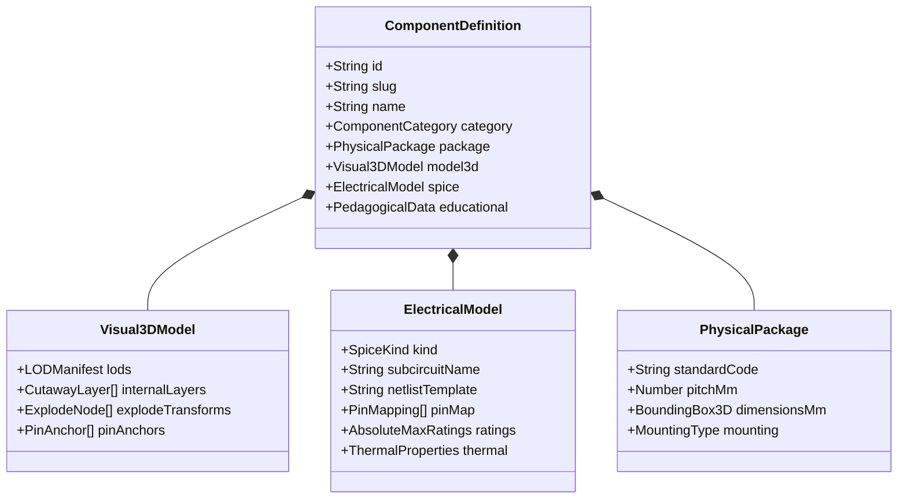

# 3D Lab — Unified Component Data Model Specification

**Document Version:** 1.0.0  
**Status:** Approved  
**Standard:** 3DLab Component Schema v1 (3DCS-1)

---

## 1. Schema Overview & Philosophy

The **Unified Component Data Model (3DCS-1)** bridges three distinct physical representations of an electronic part into a single, cohesive, versioned schema:
1. **The Physical 3D Representation:** Multi-LOD geometric meshes, internal layer hierarchies, material definitions, anchor points, and explode translation vectors.
2. **The Electrical Behavioral Representation:** SPICE simulation templates, pin-to-node mappings, operating bounds, and thermal equations.
3. **The Pedagogical Representation:** Explanations of microscopic semiconductor physics, failure mechanics, and instructional metadata.



---

## 2. Complete TypeScript Type Definitions

Below is the authoritative TypeScript interface specification residing in `@3d-lab/core-model`:

```typescript
/**
 * 3D Lab Component Schema Specification v1.0
 */

export type ComponentCategory =
  | 'passive'
  | 'discrete_semiconductor'
  | 'integrated_circuit'
  | 'opamp_linear'
  | 'electromechanical'
  | 'sensor'
  | 'optoelectronics'
  | 'power_management';

export type MountingType = 'through_hole' | 'smd' | 'chassis' | 'terminal';

export interface BoundingBox3D {
  widthMm: number;
  heightMm: number;
  depthMm: number;
}

export interface Vector3D {
  x: number;
  y: number;
  z: number;
}

/* -------------------------------------------------------------------------
 * 1. Physical Package & Anchors
 * ------------------------------------------------------------------------- */
export interface PinAnchor {
  pinId: string;
  pinNumber: number;
  name: string;
  type: 'passive' | 'input' | 'output' | 'power' | 'ground' | 'tri_state';
  /** Position in millimeters relative to package center */
  positionMm: Vector3D;
  /** Direction vector of the pin lead extending from the body */
  leadDirection: Vector3D;
  /** Standard electrical breadboard / PCB pitch snap compatibility */
  breadboardCompatible: boolean;
}

export interface PhysicalPackage {
  standardCode: string; // e.g. "TO-92", "DIP-8", "0805", "DO-35"
  mounting: MountingType;
  dimensionsMm: BoundingBox3D;
  pitchMm: number | null; // e.g. 2.54 for DIP/breadboard, 1.27 for SOIC
  pins: PinAnchor[];
}

/* -------------------------------------------------------------------------
 * 2. Visual 3D Assets & Cutaway Layers
 * ------------------------------------------------------------------------- */
export interface LODManifest {
  /** Low-poly model for dense circuit workspaces (<2k tris) */
  lod0GlbUrl: string;
  /** Medium-poly model for component viewer (<15k tris) */
  lod1GlbUrl: string;
  /** High-poly cutaway model with internal structures (<60k tris) */
  lod2GlbUrl: string;
}

export interface CutawayLayer {
  layerId: string;
  displayName: string;
  meshNodeName: string; // Name of mesh node in GLB scene graph
  materialType: 'plastic_mold' | 'copper_leadframe' | 'silicon_die' | 'gold_wirebond' | 'ceramic' | 'ferrite';
  defaultVisible: boolean;
  canClip: boolean; // Whether the dynamic stencil clipping plane affects this layer
  colorRampTarget?: 'thermal' | 'depletion_zone' | 'current_density';
}

export interface ExplodeNode {
  meshNodeName: string;
  /** Translation offset vector when exploded view is at 100% (in mm) */
  offsetMm: Vector3D;
  order: number; // Animation sequencing priority (0 = first)
}

export interface Visual3DModel {
  lods: LODManifest;
  internalLayers: CutawayLayer[];
  explodeTransforms: ExplodeNode[];
  defaultOrientation: Vector3D;
  /** Optional PBR custom material properties overrides */
  materialOverrides?: Record<string, {
    roughness?: number;
    metalness?: number;
    colorHex?: string;
    transmission?: number; // For clear LED epoxy resins
    emissive?: string;
  }>;
}

/* -------------------------------------------------------------------------
 * 3. Electrical Simulation & SPICE Model
 * ------------------------------------------------------------------------- */
export type SpiceKind = 'primitive' | 'subcircuit';

export interface PinMapping {
  pinNumber: number;
  pinName: string;
  spiceNodeOrder: number; // Order in SPICE subcircuit call (.SUBCKT node list)
}

export interface AbsoluteMaxRatings {
  maxVoltageV: number;
  maxCurrentContinuousA: number;
  maxCurrentPeakA: number;
  maxPowerDissipationW: number;
  maxJunctionTempC: number;
  minOperatingTempC: number;
}

export interface ThermalProperties {
  rThetaJA: number; // Junction-to-ambient thermal resistance (°C/W)
  rThetaJC: number; // Junction-to-case thermal resistance (°C/W)
  thermalTimeConstantSec: number;
}

export interface ElectricalModel {
  kind: SpiceKind;
  spicePrefix: 'R' | 'C' | 'L' | 'D' | 'Q' | 'M' | 'X' | 'U';
  subcircuitName?: string;
  /** Netlist template with interpolation tokens (e.g. "{NAME} {COLLECTOR} {BASE} {EMITTER} 2N3904") */
  netlistTemplate: string;
  pinMap: PinMapping[];
  ratings: AbsoluteMaxRatings;
  thermal: ThermalProperties;
  /** Complete SPICE raw model / subcircuit definition text (ngspice syntax) */
  rawSpiceModel: string;
  /** Default parameters that users can edit in the inspector */
  editableParameters?: Array<{
    name: string;
    label: string;
    unit: string;
    defaultValue: number;
    min: number;
    max: number;
  }>;
}

/* -------------------------------------------------------------------------
 * 4. Educational & Pedagogical Metadata
 * ------------------------------------------------------------------------- */
export interface PedagogicalData {
  tagline: string;
  summary: string;
  physicalOperatingPrinciple: string;
  microscopicMechanism: string; // Explains what happens at the atomic/silicon level
  commonFailureModes: Array<{
    trigger: string;
    consequence: string;
    visualEffect: 'burn_mark' | 'pop_split' | 'smoke_cloud' | 'no_visible_change';
  }>;
  datasheetUrl?: string;
  historicalContext?: string;
}

/* -------------------------------------------------------------------------
 * Root Component Definition
 * ------------------------------------------------------------------------- */
export interface ComponentDefinition {
  schemaVersion: '1.0.0';
  id: string; // Globally unique identifier, e.g. "semi_bjt_2n3904"
  slug: string; // URL and search-friendly slug, e.g. "2n3904-npn-transistor"
  name: string; // Display name, e.g. "2N3904 NPN BJT"
  category: ComponentCategory;
  package: PhysicalPackage;
  visual3d: Visual3DModel;
  electrical: ElectricalModel;
  educational: PedagogicalData;
}
```

---

## 3. Concrete Example: 2N3904 NPN Bipolar Junction Transistor

Below is a complete, valid JSON instance conforming to the schema:

```json
{
  "schemaVersion": "1.0.0",
  "id": "semi_bjt_2n3904",
  "slug": "2n3904-npn-transistor",
  "name": "2N3904 General Purpose NPN Transistor",
  "category": "discrete_semiconductor",
  "package": {
    "standardCode": "TO-92",
    "mounting": "through_hole",
    "dimensionsMm": {
      "widthMm": 4.58,
      "heightMm": 4.82,
      "depthMm": 3.86
    },
    "pitchMm": 1.27,
    "pins": [
      {
        "pinId": "pin_e",
        "pinNumber": 1,
        "name": "Emitter",
        "type": "passive",
        "positionMm": { "x": -1.27, "y": -4.0, "z": 0.0 },
        "leadDirection": { "x": 0.0, "y": -1.0, "z": 0.0 },
        "breadboardCompatible": true
      },
      {
        "pinId": "pin_b",
        "pinNumber": 2,
        "name": "Base",
        "type": "input",
        "positionMm": { "x": 0.0, "y": -4.0, "z": 0.0 },
        "leadDirection": { "x": 0.0, "y": -1.0, "z": 0.0 },
        "breadboardCompatible": true
      },
      {
        "pinId": "pin_c",
        "pinNumber": 3,
        "name": "Collector",
        "type": "passive",
        "positionMm": { "x": 1.27, "y": -4.0, "z": 0.0 },
        "leadDirection": { "x": 0.0, "y": -1.0, "z": 0.0 },
        "breadboardCompatible": true
      }
    ]
  },
  "visual3d": {
    "lods": {
      "lod0GlbUrl": "/assets/components/to92/to92_lod0.glb",
      "lod1GlbUrl": "/assets/components/to92/to92_lod1.glb",
      "lod2GlbUrl": "/assets/components/to92/2n3904_internal_lod2.glb"
    },
    "internalLayers": [
      {
        "layerId": "mold_epoxy",
        "displayName": "Epoxy Resin Mold Compound",
        "meshNodeName": "Mesh_Epoxy_Body",
        "materialType": "plastic_mold",
        "defaultVisible": true,
        "canClip": true
      },
      {
        "layerId": "leadframe",
        "displayName": "Copper Leadframe",
        "meshNodeName": "Mesh_Leadframe",
        "materialType": "copper_leadframe",
        "defaultVisible": true,
        "canClip": true
      },
      {
        "layerId": "silicon_die",
        "displayName": "Silicon NPN Die",
        "meshNodeName": "Mesh_Die",
        "materialType": "silicon_die",
        "defaultVisible": true,
        "canClip": true,
        "colorRampTarget": "depletion_zone"
      },
      {
        "layerId": "wirebonds",
        "displayName": "Gold Bond Wires (25µm)",
        "meshNodeName": "Mesh_Bond_Wires",
        "materialType": "gold_wirebond",
        "defaultVisible": true,
        "canClip": false
      }
    ],
    "explodeTransforms": [
      { "meshNodeName": "Mesh_Epoxy_Body", "offsetMm": { "x": 0.0, "y": 10.0, "z": 0.0 }, "order": 0 },
      { "meshNodeName": "Mesh_Bond_Wires", "offsetMm": { "x": 0.0, "y": 5.0, "z": 2.0 }, "order": 1 },
      { "meshNodeName": "Mesh_Die", "offsetMm": { "x": 0.0, "y": 2.0, "z": 0.0 }, "order": 2 }
    ],
    "defaultOrientation": { "x": 0.0, "y": 0.0, "z": 0.0 }
  },
  "electrical": {
    "kind": "primitive",
    "spicePrefix": "Q",
    "netlistTemplate": "Q{NAME} {COLLECTOR} {BASE} {EMITTER} Q2N3904",
    "pinMap": [
      { "pinNumber": 3, "pinName": "Collector", "spiceNodeOrder": 1 },
      { "pinNumber": 2, "pinName": "Base", "spiceNodeOrder": 2 },
      { "pinNumber": 1, "pinName": "Emitter", "spiceNodeOrder": 3 }
    ],
    "ratings": {
      "maxVoltageV": 40.0,
      "maxCurrentContinuousA": 0.2,
      "maxCurrentPeakA": 0.5,
      "maxPowerDissipationW": 0.625,
      "maxJunctionTempC": 150.0,
      "minOperatingTempC": -55.0
    },
    "thermal": {
      "rThetaJA": 200.0,
      "rThetaJC": 83.3,
      "thermalTimeConstantSec": 12.0
    },
    "rawSpiceModel": ".MODEL Q2N3904 NPN(IS=1E-14 VAF=100 BF=300 IKF=0.4 XTB=1.5 BR=4 CJC=4E-12 CJE=8E-12 RB=10 RC=1 RE=0.1 TR=239E-9 TF=400E-12)"
  },
  "educational": {
    "tagline": "Ubiquitous general-purpose small-signal NPN transistor.",
    "summary": "Used for low-power amplification and high-speed digital switching up to 100 MHz.",
    "physicalOperatingPrinciple": "Current injected into the forward-biased Base-Emitter PN junction modulates a much larger current flow from the reverse-biased Collector through the thin p-type base region.",
    "microscopicMechanism": "Electrons from the heavily-doped N+ emitter diffuse across the narrow P base where very few recombine with holes before being swept across the high electric field of the reverse-biased Base-Collector depletion layer.",
    "commonFailureModes": [
      {
        "trigger": "Base-Emitter reverse breakdown (Vbe < -6V)",
        "consequence": "Zener damage and severe degradation of beta (hFE).",
        "visualEffect": "no_visible_change"
      },
      {
        "trigger": "Thermal overload (P > 625mW sustained)",
        "consequence": "Silicon thermal runaway melting metalization contacts.",
        "visualEffect": "burn_mark"
      }
    ],
    "datasheetUrl": "https://www.onsemi.com/pdf/datasheet/2n3903-d.pdf"
  }
}
```
