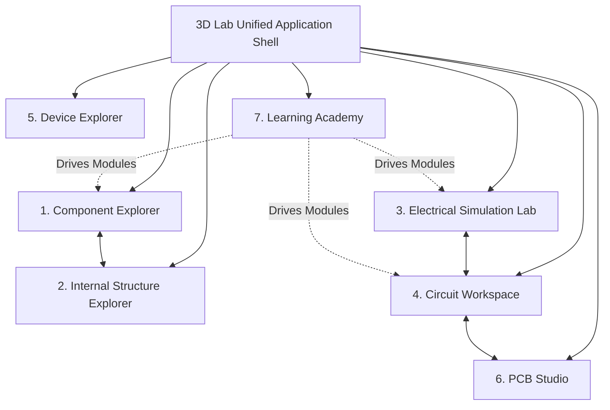

# 3D Lab — Product Requirements Document (PRD)

**Document Version:** 1.0.0  
**Status:** Approved for Architecture & Specification Phase  
**Author:** Lead Software Architect & Product Engineer  
**Target Audience:** Engineering, Product, Design, Domain Specialists (Electrical & 3D)

---

## 1. Executive Summary & Product Vision

### 1.1 Vision Statement
**3D Lab** is an interactive, browser-first electronics learning and engineering workstation designed to demystify electronics from the inside out. By bridging interactive high-fidelity 3D modeling, internal mechanical/chemical cutaways, real-time SPICE-accurate electrical simulation, practical breadboard/schematic circuit design, virtual teardowns, and guided pedagogical pathways, 3D Lab transforms abstract mathematical and schematic concepts into tangible, visual, and intuitive experiences.

### 1.2 Core Value Proposition
- **Look Inside Components:** Unlike traditional 2D schematics or high-level circuit simulators, 3D Lab reveals the physical die, wire bonds, PN junctions, dielectric layers, magnetic fluxes, and thermal dynamics of components in 3D.
- **Scientifically Grounded:** Educational animations (electron flow, field lines, thermal dissipation) are mathematically driven by a real SPICE engine (ngspice via WebAssembly), not pre-baked keyframe animations.
- **Dual-Audience Continuum:** Serves both novices needing visual intuition (Learning Academy, teardowns) and engineers needing practical schematics, SPICE waveforms, and PCB routing.
- **Browser-First, Desktop-Ready:** Zero install friction in modern WebGL2/WebGPU browsers, architected cleanly for standalone offline packaging (Tauri/Electron) without architectural rewrites.

---

## 2. User Personas & Problem Scenarios

| Persona | Background & Goals | Pain Points with Existing Tools | 3D Lab Solution |
| :--- | :--- | :--- | :--- |
| **P1: STEM Student (High School / Undergrad)** | Learning basic circuit theory (Ohm's law, RC circuits, transistor switching). Needs physical intuition. | Formulas feel disconnected from physical hardware; 2D circuit simulators (Tinkercad, Falstad) abstract away physical packaging and semiconductor physics; real labs risk burned components and lack microscopic views. | Interactive cutaway views showing electron depletion zones, current flow vectors, and safe virtual component burnouts when limits are exceeded. |
| **P2: Electronics Hobbyist & Maker** | Prototyping microcontroller circuits (Arduino/ESP32, sensors, actuators) on breadboards. | Breadboard wiring mistakes lead to confusing faults; reading datasheets is tedious; hard to visualize pinout orientation and internal component configurations. | 3D Breadboard Circuit Workspace with real-time pin probing, dynamic cutaways, and virtual multimeters/oscilloscopes. |
| **P3: Hardware Engineer / Educator** | Teaching analog/digital electronics or presenting component operational limits and failure modes. | Existing tools are either purely visual toys (no accurate physics) or complex industrial CAD/EDA (Altium/KiCad + LTspice) with steep learning curves and no internal visualization. | Combines rigorous ngspice backend simulations with cinematic 3D cutaway visualization and interactive pedagogical modules. |

---

## 3. Core Environments Specification

The application is structured into seven distinct, deeply integrated environments accessible through a unified shell:

### 3.1 Environment 1: Component Explorer
- **Purpose:** 360-degree inspection and exploration of discrete and integrated electronic components (passives, discretes, IC packages, electromechanical parts, sensors).
- **Key Features:**
  - Orbit, pan, zoom, explode-view slider (separating leads, mold compound, die, heatsinks).
  - Pinout highlighter with interactive tooltip (pin number, function, electrical ratings, internal connection).
  - Parametric live variants (e.g., changing resistor color bands updates resistance value; switching package from DIP-8 to SOIC-8 updates 3D mesh and thermal ratings).
  - Datasheet HUD overlay displaying real operating envelopes ($V_{max}$, $I_{max}$, $P_{diss}$, thermal derating curves).

### 3.2 Environment 2: Internal Structure Explorer
- **Purpose:** Deep-dive physical and physical-chemical cutaway views exposing the inner workings of components.
- **Key Features:**
  - Dynamic planar and volumetric clipping planes (X, Y, Z sliders and custom angled planes) to section through mold compound, ceramic layers, and silicon dies.
  - Layer-by-layer visibility toggles (packaging, substrate, metal interconnects, silicon die, wire bonds, PN junction regions).
  - Microscopic scale visualization: Atomic lattices, depletion zones, electron/hole recombination representations, magnetic flux loops in inductors/transformers, and dielectric charge accumulation in capacitors.
  - Micro-simulation overlay: Interactive sliders (e.g., reverse bias voltage) showing dynamic widening of the depletion layer and breakdown avalanche in real-time 3D shaders.

### 3.3 Environment 3: Electrical Simulation Lab
- **Purpose:** A virtual test bench for scientific component experimentation and characterization without breadboard wiring overhead.
- **Key Features:**
  - Virtual instruments: 4-channel Digital Storage Oscilloscope (DSO), Arbitrary Function Generator (AFG), Triple-output DC Power Supply, Digital Multimeter (DMM), and Bode Plotter.
  - Analysis modes: Transient ($V(t)$), Direct Current Operating Point (DCOP), DC Sweep (I-V curve tracer for diodes/transistors), AC Frequency Analysis (Bode plots).
  - Component stress testing: Parametric sweeps testing component destruction, thermal runaway, and dielectric breakdown with realistic visual failure states (smoke, charring, LED popping).

### 3.4 Environment 4: Circuit Workspace
- **Purpose:** Interactive 3D breadboard and schematic construction environment.
- **Key Features:**
  - Dual synchronized viewports: Synchronous Split-Screen or Toggle between Photorealistic 3D Breadboard View and Standard 2D Schematic View.
  - Drag-and-drop wiring with realistic catenary wire physics, color coding, wire stripping, and neat routing guides.
  - Real-time simulation loop: Live node voltages and branch currents calculated continuously; probe any lead to see live HUD readings.
  - Interactive parts: Pushbuttons, potentiometers with draggable knobs, DIP switches, LEDs that illuminate with lumen-accurate emissivity, and 7-segment displays.

### 3.5 Environment 5: Device Explorer (Teardowns)
- **Purpose:** Assembly and disassembly of complex consumer and industrial electronic devices (e.g., smartphone, power supply, dynamic microphone, brushless motor controller).
- **Key Features:**
  - Step-by-step guided disassembly sequence with screw extraction, ribbon cable unseating, and thermal paste reveals.
  - Hierarchical sub-assembly tree: Device $\rightarrow$ Sub-chassis $\rightarrow$ PCB $\rightarrow$ Subsystems $\rightarrow$ Individual Components.
  - System signal flow mode: Visualizing power distribution rails and high-speed data buses across multiple boards and ribbon interconnects.

### 3.6 Environment 6: PCB Studio
- **Purpose:** Bridge the gap between prototype breadboards and manufacturing by visualizing printed circuit board layers, traces, vias, and design rules.
- **Key Features:**
  - Stackup inspector: Solder mask, copper top, prepreg, core, copper bottom, silkscreen layers with independent opacity and thickness controls.
  - Interactive trace highlighter: Click any net to illuminate its entire 3D copper path through microvias and internal plane layers.
  - Gerber and KiCad/Specctra netlist viewer: Import capability for community boards and basic export for manufacturing education.

### 3.7 Environment 7: Learning Academy
- **Purpose:** Structured, pedagogical curriculum with interactive guided challenges and gamified diagnostics.
- **Key Features:**
  - Interactive lessons indexed from fundamentals (Ohm's Law, Kirchoff's Laws) to advanced topics (Op-Amp feedback topologies, MOSFET gate charge, switching regulators).
  - "Fix the Fault" challenge mode: Injects simulated defects (cold solder joints, blown bypass capacitors, reversed polarity diodes, internal short circuits) for users to troubleshoot using virtual test gear.
  - Embedded checkpoints with knowledge verification and simulation-driven validation criteria.

---

## 4. Requirements Matrix

### 4.1 Functional Requirements (FR)
- **FR-01 (Component Parametric Modeling):** The system shall generate and render physically accurate 3D representations of standardized electronic components with real-world dimensions (metric millimeter tolerances).
- **FR-02 (Cutaway Shading):** The 3D engine shall support real-time arbitrary plane slicing without generating non-manifold geometries, rendering cut surfaces with distinct material caps.
- **FR-03 (SPICE Netlist Synthesis):** The circuit workspace shall compile 3D breadboard connections and 2D schematics into clean SPICE netlists with node numbering, parasitic estimations, and tolerance assignments.
- **FR-04 (Dual-Engine Electrical Simulation):**
  - Interactive/Real-time mode: Lightweight MNA (Modified Nodal Analysis) solver running at 60 Hz for responsive breadboard interactions.
  - Precision mode: WebAssembly-compiled ngspice solver for accurate non-linear transient, AC, and Fourier analyses.
- **FR-05 (Simulation-Driven Animation):** Real-time node voltages and branch currents from the simulation engine must directly drive vertex/fragment shaders (e.g., drift velocity of charge particles, LED radiometric flux, resistor thermal heat-map color).
- **FR-06 (Failure & Overstress Simulation):** If calculated electrical power or reverse breakdown exceeds component datasheet limits ($P_{diss} > P_{max}$), the system shall trigger visual, physical, and electrical failure states.
- **FR-07 (Multi-state Camera & Navigation):** The viewport shall support OrbitControls, First-Person Inspection, Pin Tracking, and preset views (Top/Front/Isometric/Cutaway macro) with smooth interpolated transitions.
- **FR-08 (Undo/Redo & State Persistence):** Full serialization of circuit states, camera views, and user annotations into human-readable JSON files, with comprehensive undo/redo history stacks.

### 4.2 Non-Functional Requirements (NFR)
- **NFR-01 (Frame Rate Performance):** 60 FPS minimum on mid-tier hardware (integrated graphics such as Intel Iris Xe or Apple M1 base) with up to 150 components and 500 wires on screen.
- **NFR-02 (Simulation Responsiveness):** Interactive MNA simulation loop must execute within $<16.6\text{ ms}$ per step. Precision ngspice WASM runs must execute off the main thread in a dedicated Web Worker to prevent UI freezes.
- **NFR-03 (Initial Load & Bundle Size):** First Contentful Paint (FCP) $<1.5\text{ s}$, Initial JS bundle $<350\text{ KB}$ (gzipped, excluding 3D asset chunks), WASM simulation core loaded lazily on demand ($<2.5\text{ MB}$).
- **NFR-04 (Asset Optimization):** All 3D models streamed in optimized glTF / GLB format using Draco or Meshopt compression and KTX2 / Basis Universal GPU textures.
- **NFR-05 (Browser Compatibility):** Support all modern browsers with WebGL 2.0 and WebAssembly support (Chrome/Edge 90+, Firefox 90+, Safari 15.4+). Architectural forward compatibility with WebGPU.
- **NFR-06 (Accessibility & Responsiveness):** Keyboard navigation for all UI controls, WCAG AA color contrast compliance on technical UI overlays, fluid adaptation across screen resolutions ($1280\times 720$ up to $3840\times 2160$).

---

## 5. Architectural Conflicts, Unrealistic Assumptions & Mitigations

During our architectural analysis, five critical conflicts and unrealistic assumptions were identified. Below are the engineering assessments and concrete mitigations:

| Conflict / Unrealistic Assumption | Risk Analysis | Engineering Mitigation |
| :--- | :--- | :--- |
| **1. Real-time 60 FPS SPICE with ngspice in Browser** | ngspice is an iterative matrix solver written in C. Running complex non-linear transient calculations synchronously inside the UI render loop will stall frames and drop framerates to $<10\text{ FPS}$. | **Dual-Engine Architecture:** Use a fast, simplified linear/piecewise-linear MNA solver in JS/Wasm for real-time 60 FPS breadboard interactions (live LED glows, meter needle sweeps). Delegate high-precision transient, frequency, and deep semiconductor simulation to **ngspice-wasm running in a dedicated background Web Worker**, streaming time-series buffers to the UI. |
| **2. Arbitrary 3D Mesh Boolean Cutaways in Real-Time** | Real-time CSG (Constructive Solid Geometry) mesh booleans are CPU-expensive and generate irregular geometry, causing frame drops and texture misalignment on mobile/integrated GPUs. | **Multi-Material Clip Planes & Stencil Caps:** Implement GPU-accelerated analytical clipping planes (`gl_ClipDistance` / Three.js clipping planes) combined with custom stencil buffer passes to dynamically cap internal surfaces without altering underlying mesh topology. |
| **3. Microscopic Physics vs. Macroscopic Circuit Simulation** | Microscopic semiconductor physics (charge carrier diffusion, drift, quantum tunneling) operate on PDE partial differential equations (drift-diffusion models), which cannot be solved in real-time across an entire circuit. | **Decoupled Hierarchical Models:** In Circuit Workspace, components are represented by lumped-element SPICE models. When entering the Internal Structure Explorer, the system transitions to a specialized 1D/2D numerical or pre-calculated parametric vector field shader, calibrated accurately to the SPICE operating point. |
| **4. Monolithic Asset Bloat** | Loading detailed 3D CAD models with internal dies and wirebonds for 100+ components on a breadboard will exceed GPU VRAM (several gigabytes) and take minutes to download. | **LOD (Level of Detail) & Hierarchical Loading:** External packaging models (LOD 0/1/2) are loaded for circuit workspace ($<50\text{ KB}$ per component). Internal die, bond wires, and micro-geometry are loaded lazily on demand only when the user enters Component Explorer or Internal Structure Explorer. |
| **5. Full EDA/ECAD Parity in Browser** | Attempting to replicate full Altium/KiCad multi-layer routing, high-speed differential signal integrity, and DRC in Phase 1 creates massive scope creep and impossible deadlines. | **Strict Scope Boundary:** Phase 1 focuses on educational and prototyping fidelity: 2-layer PCB visualization, schematic-to-breadboard translation, and core SPICE analysis. Full multi-layer auto-routing is explicitly deferred to later milestones. |

---

## 6. Scope Boundaries & Out-of-Scope Declarations

### In-Scope (Foundational Release)
- Comprehensive standard catalog of 100+ fundamental components (resistors, capacitors, inductors, diodes, BJTs, MOSFETs, Op-Amps, 555 timers, basic logic gates, switches, LEDs).
- Real-time breadboard wiring and schematic generation.
- Cutaway inspection with interactive clipping planes and internal layer visibility.
- Web Worker-driven electrical simulation (DC, Transient, AC) with virtual oscilloscope and multimeter.
- 5 comprehensive Device Teardowns with step-by-step disassembly.
- 20 interactive Learning Academy curriculum modules.

### Explicitly Out-of-Scope (v1.0)
- High-frequency RF electromagnetic field solvers (Finite Element Method / FDTD like Ansys HFSS).
- Full autorouting multi-layer PCB production engines.
- Microcontroller assembly-level cycle-accurate firmware emulators (e.g. running compiled ARM/AVR hex files directly; behavioral simulated logic is supported instead).
- Multi-user collaborative real-time editing (deferred to Phase 3).
