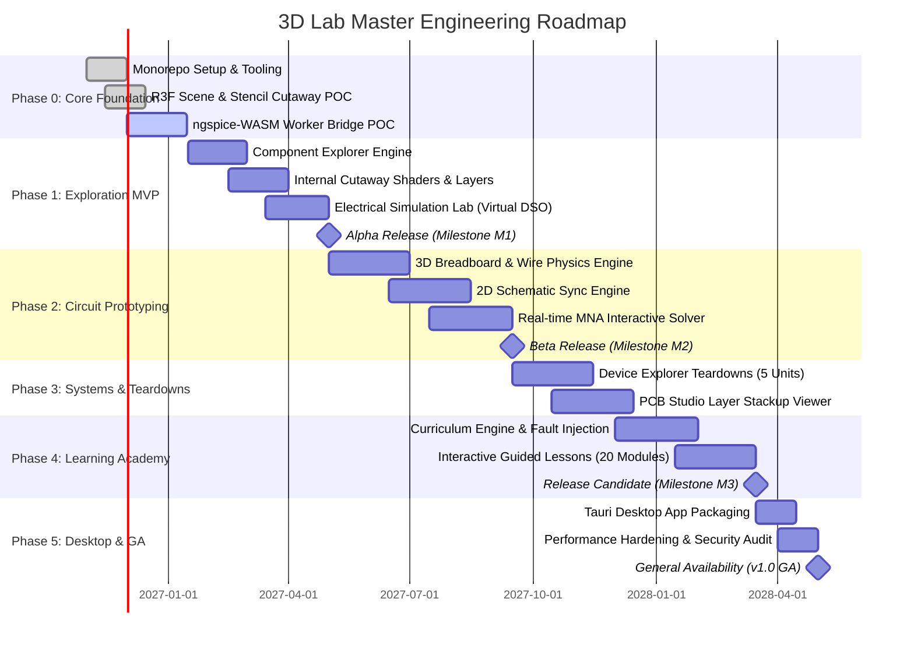

# 3D Lab — Product & Engineering Roadmap

**Document Version:** 1.0.0  
**Status:** Approved  
**Lifecycle Horizon:** 18 Months (Phases 0 through 5)

---

## 1. Roadmap Overview & Phasing Strategy

The development of 3D Lab follows a risk-mitigated, engine-first methodology. Core rendering, asset optimization pipelines, and WebAssembly simulation loops are proven and stabilized before scaling UI surfaces and curriculum content.

---

## 2. Milestone Details & Deliverables

### Phase 0: Architectural Spike & Core Engine Foundation (Weeks 1–8)
- **Objective:** De-risk the two hardest technical bottlenecks: WebAssembly SPICE simulation speed and GPU stencil cutaway performance.
- **Key Deliverables:**
  - Modern TypeScript monorepo setup (Turborepo + Next.js + R3F + Tailwind).
  - Web Worker-hosted `ngspice.wasm` compiled with Emscripten, executing transient analysis and streaming back $100{,}000$ points within $<50\text{ ms}$.
  - Three.js stencil-buffered multi-plane cutting POC displaying solid caps without geometric mesh degradation.
  - Core component schema definition (JSON Schema + TypeScript validation with Zod).

### Phase 1: MVP — Component Explorer, Cutaways & Simulation Lab (Weeks 9–20)
- **Objective:** Deliver standalone value for inspecting discrete components and testing them with virtual instruments.
- **Key Deliverables:**
  - **Component Explorer:** 360-degree orbit viewer, pinout HUD, dynamic exploded-view slider.
  - **Internal Structure Explorer:** X/Y/Z cutting planes, microscopic semiconductor layer views (die, wirebonds, depletion regions).
  - **Electrical Simulation Lab:** Virtual 4-channel DSO, DC Power Supply, DMM, and automated I-V curve tracer for diodes/transistors.
  - Initial catalog of 25 core components (Resistors, Capacitors, Inductors, Diodes, LEDs, NPN/PNP Transistors, N-MOSFETs, Op-Amps, 555 Timer).
- **Exit Gate (Milestone M1 — Private Alpha):** Tested across Chrome, Edge, Safari, and Firefox achieving sustained 60 FPS on integrated GPUs.

### Phase 2: Circuit Workspace & Interactive Prototyping (Weeks 21–34)
- **Objective:** Enable users to assemble live circuits on a virtual 3D breadboard and observe real-time simulation.
- **Key Deliverables:**
  - 3D Breadboard with spring-contact snap grid and catenary wire physics.
  - Synchronous 2D Schematic generator with automatic component symbol mapping.
  - Interactive MNA real-time simulation engine calculating live node voltages and currents at 60 Hz.
  - Visual simulation bridges: electron drift animation, LED emissivity, resistor thermal dissipation, component blowouts on overstress.
  - Undo/Redo temporal transaction system and `.3dlab` project export/import.
- **Exit Gate (Milestone M2 — Public Beta):** Ability to assemble complex analog circuits (e.g., multivibrator, 555 PWM generator, active audio filter) with real-time feedback.

### Phase 3: Device Explorer & PCB Studio (Weeks 35–44)
- **Objective:** Provide macroscopic system perspective through virtual teardowns and PCB layer stackup inspection.
- **Key Deliverables:**
  - **Device Explorer:** 5 interactive teardown models:
    1. Regulated Linear DC Bench Power Supply.
    2. Dynamic Cardioid Microphone.
    3. Digital Multimeter.
    4. Brushless DC Motor & ESC.
    5. Smartphone Sub-chassis.
  - Disassembly step player with interactive screw extraction and cable unseating.
  - **PCB Studio:** 2-to-6 layer stackup inspector with copper net highlighting, Gerber/KiCad netlist parser, and surface mount component population.

### Phase 4: Learning Academy & Curriculum Engine (Weeks 45–54)
- **Objective:** Transform the tool into a complete pedagogical learning platform with structured courses and fault diagnostics.
- **Key Deliverables:**
  - 20 interactive guided courses covering DC basics, AC reactance, active semiconductors, and analog signal conditioning.
  - Gamified "Fix the Fault" challenges with stochastic component faults (dry solder joints, burnt resistors, shorted capacitors).
  - In-app progress tracking, mastery checkpoints, and guided interactive tooltips.
- **Exit Gate (Milestone M3 — Release Candidate):** Pedagogical review and verification by university electrical engineering educators.

### Phase 5: Desktop Packaging, Polish & General Availability (Weeks 55–60)
- **Objective:** Cross-platform native releases, end-to-end performance optimization, and v1.0 launch.
- **Key Deliverables:**
  - Native standalone desktop application built with Tauri for Windows, macOS (Universal), and Linux.
  - Full offline capability with local asset bundle hydration.
  - Comprehensive memory leak audit, shader warm-up optimizations, and WebGPU fallback pipeline.
  - Final documentation, user manual, and developer SDK for custom component authoring.
- **Exit Gate (Milestone M4 — v1.0 GA):** General public release.

---

## 3. Technical Risks, Dependencies & Mitigation Matrix

| Risk Category | Specific Risk Description | Impact | Likelihood | Mitigation Strategy |
| :--- | :--- | :--- | :--- | :--- |
| **Performance** | WebGL context loss or VRAM exhaustion with multiple complex models. | Critical | Medium | Strict asset budgets ($<2\text{ MB}$ per model), aggressive LOD switching, shared geometry/material instancing, and automatic texture downscaling on mobile/low-end GPUs. |
| **Simulation** | ngspice-wasm convergence failures (`Timestep too small` / singular matrix) crashing worker. | High | High | Wrap SPICE solver in watchdog process; implement automatic fallback to conservative convergence settings (`reltol=0.01`, `gmin=1e-10`); provide friendly user guidance on floating nodes. |
| **Math / Physics** | Stiff differential equations in switching circuits (e.g. buck converters) causing severe lag. | High | Medium | Adaptive time-stepping with fixed maximum solver time per frame ($5\text{ ms}$ budget); drop visual particle density during transient spikes. |
| **Tooling** | Complex 3D CAD to Web-ready glTF manual conversion overhead. | Medium | High | Build an automated Node.js asset pipeline tool using `@gltf-transform` to batch-compress, generate LODs, and optimize materials directly from Blender/CAD exports. |
| **Platform** | Safari WebGL2/WebAssembly memory quirks and iOS Safari audio/context limits. | Medium | Medium | Automated multi-browser Playwright/WebKit test suite; polyfills for WebAssembly SharedArrayBuffer headers (`COOP`/`COEP`). |
