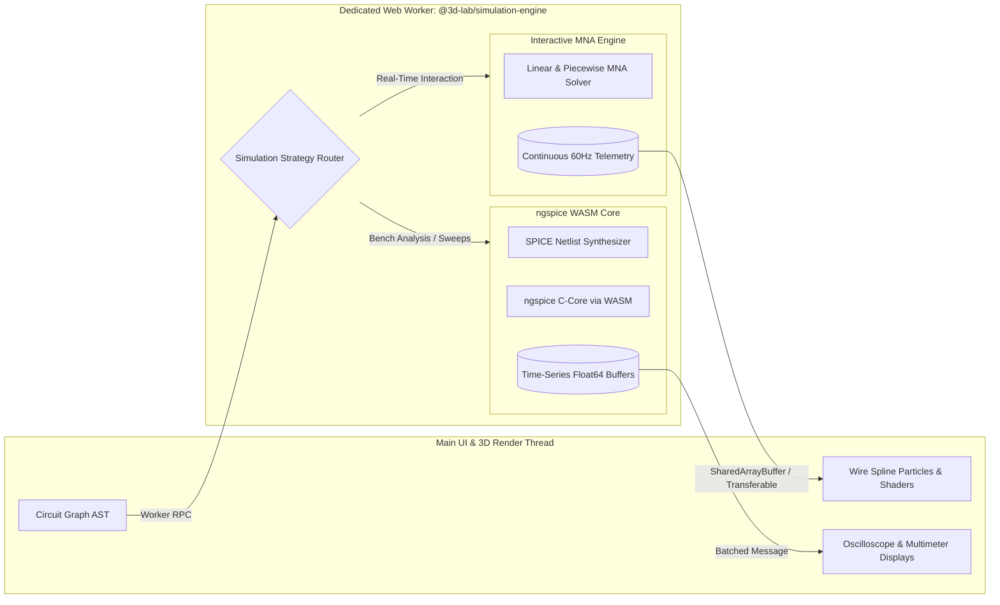

# 3D Lab — Electrical & Physical Simulation Specification

**Document Version:** 1.0.0  
**Status:** Approved  
**Engines:** ngspice (WebAssembly) & Real-Time MNA Solver (WebAssembly/JS)

---

## 1. Executive Summary & Dual-Engine Architecture

Electrical simulation in 3D Lab bridges microscopic physics, macroscopic schematic math, and real-time 3D animation. Because full SPICE matrix decomposition is non-linear and computationally intensive, 3D Lab implements a **Dual-Engine Architecture**:



1. **Interactive Real-Time MNA Engine:** Dedicated to the 3D Breadboard Circuit Workspace. Executes a linear and piecewise-linear Modified Nodal Analysis loop at $60\text{ Hz}$ to $1\text{ kHz}$. Provides continuous node voltages and branch currents to drive 3D particle animations, meters, and LED illumination without frame drops.
2. **Precision ngspice WebAssembly Engine:** Compiled directly from ngspice C source via Emscripten. Solves non-linear transient, AC frequency (Bode), DC operating point, and Fourier analyses with industrial precision. Feeds the Virtual Oscilloscope, Bode Plotter, and Semiconductor Curve Tracer.

---

## 2. ngspice WebAssembly Integration & Compilation Pipeline

### 2.1 Emscripten Compilation Configuration
ngspice (version 42+) is compiled with Emscripten into a stand-alone WebAssembly binary (`ngspice.wasm`) and JavaScript glue wrapper (`ngspice.js`).

**Target Compiler Flags:**
```bash
emcc \
  -O3 \
  -msimd128 \
  -s WASM=1 \
  -s ALLOW_MEMORY_GROWTH=1 \
  -s INITIAL_MEMORY=33554432 \
  -s MAXIMUM_MEMORY=268435456 \
  -s MODULARIZE=1 \
  -s EXPORT_NAME='createNgspiceModule' \
  -s EXPORTED_FUNCTIONS='["_ngSpice_Init", "_ngSpice_Circ", "_ngSpice_Command", "_ngSpice_AllPlots", "_ngSpice_AllVecs", "_ngGet_Vec_Info", "_main"]' \
  -s EXPORTED_RUNTIME_METHODS='["ccall", "cwrap", "UTF8ToString", "stringToUTF8", "setValue", "getValue"]' \
  -DNGSPICE_WASM_STANDALONE \
  -o packages/simulation-engine/wasm/ngspice.js
```

### 2.2 Worker RPC Protocol & Lifecycle
Communication between the main application thread and the simulation worker adheres to a strict typed message exchange:

```typescript
// RPC Message Types
export type WorkerRequest =
  | { type: 'INIT_ENGINE'; wasmUrl: string }
  | { type: 'LOAD_NETLIST'; netlist: string }
  | { type: 'RUN_TRANSIENT'; tstep: number; tstop: number; tstart?: number }
  | { type: 'RUN_AC'; variation: 'dec' | 'oct' | 'lin'; points: number; fstart: number; fstop: number }
  | { type: 'RUN_DC'; srcName: string; start: number; stop: number; step: number }
  | { type: 'STEP_INTERACTIVE'; inputs: Record<string, number> }
  | { type: 'ABORT_SIMULATION' };

export type WorkerResponse =
  | { type: 'ENGINE_READY'; version: string }
  | { type: 'SIMULATION_PROGRESS'; progress: number }
  | { type: 'SIMULATION_COMPLETE'; runId: string; vectors: Record<string, Float64Array>; timeSteps: Float64Array }
  | { type: 'INTERACTIVE_TELEMETRY'; nodeVoltages: Float32Array; branchCurrents: Float32Array }
  | { type: 'SIMULATION_ERROR'; code: 'CONVERGENCE_FAIL' | 'SINGULAR_MATRIX' | 'SYNTAX_ERROR'; message: string; line?: number };
```

---

## 3. Netlist Synthesis & Compilation Engine

The netlist compiler transforms the high-level topological circuit graph (breadboard holes, wire splines, component pins) into valid SPICE netlists.

### 3.1 Node Numbering & Topological Extraction
1. **Disjoint Set (Union-Find):** All physically or electrically connected pins, breadboard tie-points, and wire endpoints are unified into distinct electrical equivalence classes.
2. **Ground Reference Assignment:**
   - If a ground symbol or DC power supply negative terminal is present, its equivalence class is assigned node `0`.
   - If no ground is designated, the compiler automatically pins the lowest-impedance return path to node `0` and issues an educational guidance notice to the user.
3. **Parasitic Modeling (Optional High-Frequency Mode):**
   - Breadboard contact capacitance ($C_{\text{parasitic}} \approx 2\text{–}4\text{ pF}$ between adjacent rows).
   - Real jumper wire resistance ($R_{\text{wire}} \approx 0.05\text{ }\Omega$) and inductance ($L_{\text{wire}} \approx 10\text{ nH}$).

### 3.2 Netlist Output Example
```spice
* 3D Lab Generated SPICE Netlist - Monostable 555 Timer Circuit
.TITLE Monostable 555 Timer
V1 1 0 DC 9.0
R1 1 2 10k
C1 2 0 100u IC=0
X_U1 0 3 2 1 0 4 2 1 LM555
R_LOAD 4 0 1k
D1 4 5 LED_RED
R_LIMIT 5 0 220
.MODEL LED_RED D(IS=1E-20 N=1.5 RS=2 BV=5 IBV=10U)
.SUBCKT LM555 1 2 3 4 5 6 7 8
* Internals ...
.ENDS LM555
.TRAN 100u 2.5s UIC
.END
```

---

## 4. Simulation-Driven 3D Visualization Pipeline

The core product principle demands that animations are mathematically derived from physics rather than pre-baked art assets:

```
[Simulation Worker Output]
        |
        v
+-------------------+--------------------+--------------------+--------------------+
| Branch Current I  | Node Voltage V     | Power Dissipation  | Junction Bias V_pn |
+-------------------+--------------------+--------------------+--------------------+
        |                   |                    |                    |
        v                   v                    v                    v
[Drift Velocity]    [Electric Field E]   [Thermal Heat-Map]   [Depletion Zone]
instanced particles  field line vectors   vertex color ramp    custom GLSL shader
along wire curves    between conductors   T_j = T_amb + P*Rth  plane displacement
```

### 4.1 Electron Drift Velocity & Wire Particles
- Jumpers and breadboard traces host an instanced particle buffer ($N = 20\text{–}60$ glowing electron spheres per wire).
- Particle position along the Catmull-Rom spline curve is evaluated per frame:
  $$s(t + \Delta t) = \left(s(t) + \vec{v}_{\text{drift}} \cdot \Delta t\right) \pmod{L_{\text{wire}}}$$
- Velocity $\vec{v}_{\text{drift}}$ is proportional to the calculated branch current $I$:
  $$\vec{v}_{\text{drift}} = \text{sign}(I) \cdot v_{\text{scale}} \cdot \log_{10}\left(1 + \frac{|I|}{I_{\text{ref}}}\right)$$
  *(Logarithmic scaling ensures visibility of tiny microamp currents without rendering kiloamp currents into an unintelligible blur).*

### 4.2 Radiometric LED Emission & Optoelectronics
- LED emission does not use a binary "on/off" switch. It calculates radiometric luminous flux $\Phi_v$ from diode forward current:
  $$\Phi_v = \Phi_{\text{rated}} \cdot \left(\frac{\max(0, I_{\text{forward}} - I_{\text{threshold}})}{I_{\text{test}}}\right)^{\gamma}$$
- Values update Three.js PointLight intensity and dynamic fragment shader bloom emissivity in the 3D scene.

### 4.3 Thermal Dynamics & Heat-Map Shading
- Component power dissipation is calculated at each step:
  $$P_D = V_{\text{component}} \cdot I_{\text{component}}$$
- Component junction temperature $T_j$ follows a first-order thermal differential equation:
  $$\frac{dT_j}{dt} = \frac{P_D \cdot R_{\theta JA} - (T_j - T_{\text{ambient}})}{\tau_{\text{thermal}}}$$
- $T_j$ is passed as a uniform to the component cutaway shader, shifting vertex color from nominal grey through warm yellow, orange, and incandescent cherry red ($>150^\circ\text{C}$).

### 4.4 Microscopic Semiconductor Depletion Layer
- In the Internal Structure Explorer, the PN junction width $W_{\text{dep}}$ is rendered dynamically in GLSL:
  $$W_{\text{dep}}(V_{\text{bias}}) = \sqrt{\frac{2\varepsilon}{q}\left(\frac{N_A + N_D}{N_A N_D}\right)(V_{bi} - V_{\text{bias}})}$$
- Applying reverse bias increases $W_{\text{dep}}$, widening the visually clear depletion barrier between the P-type (blue) and N-type (red) silicon die regions.

---

## 5. Overstress, Failure Modes & Visual Destruction Engine

When simulated electrical stress exceeds a component's Absolute Maximum Ratings ($P > P_{\max}$, $V_{\text{reverse}} > V_{\text{breakdown}}$, or $T_j > T_{j,\max}$), the system transitions the part into a permanent or temporary failure state:

| Failure Type | Electrical Trigger Condition | SPICE Internal Transformation | 3D Visual & Auditory Feedback |
| :--- | :--- | :--- | :--- |
| **Resistor Burnout** | $P_{\text{diss}} > 2.5 \times P_{\text{rated}}$ for $>1.5\text{ s}$ | Replaced with Open-Circuit ($R \rightarrow 10^9\text{ }\Omega$) | Smoke particle puff, charred dark carbonization shader patch, faint popping audio cue. |
| **Capacitor Overvoltage** | $V_{\text{applied}} > 1.25 \times V_{\text{rated}}$ | Replaced with Short-Circuit ($R \rightarrow 0.1\text{ }\Omega$) followed by Open | Electrolytic top vent expansion bulge, dielectric blowout puff. |
| **LED Reverse Breakdown** | $V_{\text{rev}} > V_{\text{BR}}$ (typically $5\text{V}$) | Diode model permanently shorted | Instant flash, blackened die, epoxy casing micro-crack. |
| **Transistor Thermal Runaway**| $T_j > 175^\circ\text{C}$ | BJT Collector-Emitter short circuit | Epoxy mold compound discolors and emits sustained smoke plume. |

---

## 6. Convergence, Floating Nodes & Solver Stability

To prevent solver crashes and cryptic error screens:
1. **Floating Node Detection:** The netlist generator runs a connected-component graph check before passing netlists to ngspice. Isolated pins or floating sub-networks are automatically tagged with high-impedance shunt resistors to ground ($R_{\text{shunt}} = 1\text{ G}\Omega$) and highlighted in yellow on the UI.
2. **Convergence Watchdog:** If ngspice fails to converge (`Timestep too small` in transient analysis), the worker catches the error, automatically adjusts convergence options:
   ```spice
   .OPTIONS RELTOL=0.01 ABSTOL=1N VNTOL=1M GMIN=1E-11 ITL4=100
   ```
   and restarts the step.
3. **Worker Auto-Recovery:** If a WASM out-of-memory or fatal segfault occurs, the Web Worker watchdog terminates and respawns the worker within $<100\text{ ms}$, notifying the user with actionable circuit troubleshooting tips.
